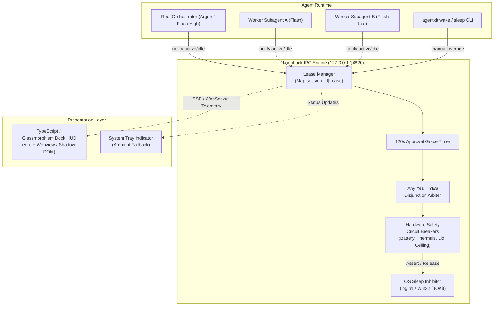
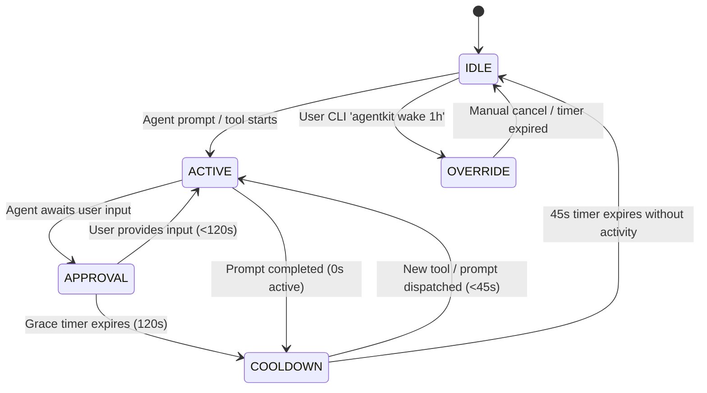

# ADR 0013: Dock-Based Caffeine HUD and Visual Design

## Status
Accepted

## Date
2026-11-06

---

## Context

### 1. Evolution from Basic Wake Lock to Dock-Based Ambient HUD
In ADR 0012, `agentkit` introduced a cross-platform sleep inhibition subsystem (`agentkit wake`) consisting of a decoupled power engine (`login1`, `SetThreadExecutionState`, `caffeinate`), a loopback IPC server on `127.0.0.1:18820`, and an initial desktop tray applet implemented in PyQt6 (`project/tools/wake/tray.py`).

While the PyQt6 system tray applet successfully proved the viability of ambient sleep inhibition, practical usage across developer workstations revealed four significant limitations:
1. **Heavy PyQt6 Footprint & Platform Friction**: PyQt6 introduces large binary dependencies (~150MB+ runtime), requires Qt6 platform plugins (`xcb`, `wayland`), and frequently encounters initialization failures in minimal Linux workstations, headless containers, or customized Wayland compositors (such as modern KDE Plasma 6 sessions).
2. **Poor Visual Hierarchy & Spatial Inconvenience**: System tray icons are tucked into desktop panel corners where status changes, cooldown counters, and active session details are easily overlooked on ultra-wide or multi-monitor setups.
3. **Information Density Bottlenecks**: A static $24\times24$ tray icon cannot cleanly display rich telemetry (such as active subagent names, countdown progress bars, elapsed prompt timers, or hardware safety warnings) without requiring the developer to click into a modal menu.
4. **Lack of Glassmorphic Desktop Modernity**: Modern developer environments demand clean, fluid, hardware-accelerated user interfaces matching the system theme rather than dated desktop widget frameworks.

To evaluate an improved design, an interactive high-fidelity prototype was authored at [`docs/hud_interactive_demo.html`](file:///home/cooper/Projects/agentkit/docs/hud_interactive_demo.html), validating a floating glassmorphic dock pill that can dock dynamically across screen edges and expand on demand.

### 2. Multi-Agent Concurrency & Race Conditions
Modern agent workflows governed by `auto-lifecycle` and cognitive tiering frequently execute multiple agent threads concurrently:
- A root reasoning orchestrator (Gemini 4 Argon, Gemini 3.8 Flash High, Claude Opus 5.5).
- Multiple parallel worker subagents (Gemini 3.8 Flash, Flash Lite) executing in isolated git worktrees across disjoint files.

Under a primitive binary lock (`locked = True/False`), when Subagent A finishes its task and posts an idle notification, a naive daemon releases the OS sleep inhibitor immediately—even though Subagent B and the root orchestrator are still actively processing code or running tests. A robust multi-agent architecture requires discrete **lease tracking** indexed by unique session identifiers (`session_id`), evaluated by an arbiter to prevent premature suspension.

### 3. User Approval Idle Drops
Autonomous pair-programming sessions frequently pause to solicit human input or clarification:
- Interactive confirmation gates (e.g. reviewing `plan.md`, granting tool bypass, or approving critical mutations).
- Multi-choice prompts (`ask_question`).
- Authentication prompts for external services.

During these approval pauses, no CPU-intensive tool or subprocess is actively executing. Standard operating system power managers detect this lack of keyboard/mouse input and trigger screen sleep or host suspension, freezing the agent session while the developer is briefly away or reading documentation. The architecture must account for human deliberation intervals without dropping the wake lock.

### 4. Unattended Hardware Safety Risks
Long-running agent workflows (such as extensive test suite discovery, multi-repository migrations, or overnight `/goal` runs) are frequently executed on battery-powered laptops. Unsupervised sleep inhibition poses serious hardware risks:
- **Battery Depletion to Critical Thresholds**: Running intensive LLM reasoning and build pipelines on battery until 0% risks sudden system shutdown, uncommitted state loss, and battery degradation.
- **Thermal Runaway**: Sustained multi-core compilation or test runs with blocked laptop vents can push chassis temperatures into dangerous ranges ($> 90^\circ\text{C}$).
- **Closed-Lid Thermal Traps**: Transporting or storing a laptop in a bag while a wake lock forces the machine to stay awake with the lid closed can cause severe overheating.
- **Runaway Executions**: Faulty agent prompt loops or hanging processes could hold hardware awake indefinitely without an enforced execution boundary.

### 5. Language Migration Roadmap
As `agentkit` matures into an enterprise-grade agent harness, the background runtime is migrating towards a dual-language architecture:
- **Background Daemon Engine**: Migrating from Python 3 to a high-performance, single-binary **Go daemon** (`agentkit-daemond` on `127.0.0.1:18820`) offering native D-Bus integration, minimal memory overhead (<15MB RSS), and zero Python runtime dependencies.
- **Presentation Layer**: Migrating from PyQt6 to **TypeScript + HTML5/CSS Glassmorphism** packaged via Vite and rendered in an ultra-lightweight Webview or Shadow DOM dock.

---

## Decision

We adopt the **Dock-Based Caffeine Heads-Up Display (HUD)** architecture as the canonical visual and power-management interface for `agentkit`.



---

### 1. Visual Anatomy & Screen Docking Layout

The HUD presentation layer is structured as a floating dockable pill capable of operating in two distinct display modes:

```text
+---------------------------------------------------------------------------------+
|  (O)  [AGY]  Prompt Turn Running  02:45                   [ SLEEP LOCKED ]       |
|              Subagent A: tests/test_guard.py                                    |
|              [======================--------------------]  (45s Cooldown Bar)   |
+---------------------------------------------------------------------------------+
                                      |
                              (Click to Expand)
                                      v
+---------------------------------------------------------------------------------+
|  Target Session:      feat/guard-sleep-inhibition                               |
|  Inhibition Lock:     D-Bus login1 (FD #18)                                     |
|  Display Policy:      Screen Lock Allowed (Save Power)                          |
|  Total Saved Today:   1h 48m (4 prompt turns)                                   |
|  [ Close Details ]                     [ Force Awake ]       [ Dismiss to Idle ]|
+---------------------------------------------------------------------------------+
```

1. **Compact HUD Pill (Default View)**:
   - **Dimensions**: `height: 38px`, `min-width: 340px`, `border-radius: 9999px` (pill geometry).
   - **Pulse Ring**: Hardware-accelerated CSS glowing pulse indicator reflecting runtime activity.
   - **Agent Tag**: High-contrast badge (`AGY`, `AGENTKIT`, `WORKER`) identifying executing context.
   - **Status Line**: Active operation text (e.g., `Prompt Turn Running`, `Approval Requested`, `Cooldown Buffer`).
   - **Telemetry Subtext & Elapsed Timer**: Dynamic execution duration (`MM:SS`) and active subtask metadata.
   - **Sleep Lock Badge**: Highlighting inhibition state (`SLEEP LOCKED`, `COOLDOWN 45s`, `MANUAL LOCK`).
   - **Anti-Flapping Progress Bar**: 3px linear countdown bar that drains during cooldown periods.

2. **Expanded Session Details Card (On Hover/Click)**:
   - Expands vertically to reveal deep diagnostic metadata:
     - Target git branch and active session UUID.
     - Active platform inhibitor handle (e.g., D-Bus `login1` file descriptor, Windows execution flags).
     - Display policy indicator (e.g., CPU awake while permitting screen lock/dimming).
     - Cumulative daily sleep prevention telemetry.
     - Interactive controls: manual override toggle, prompt dismiss, and card close.

3. **Dynamic Docking Geometries**:
   - The HUD can be positioned across three primary desktop docking zones:
     - `pos-top-center` (Default): Centered at the top of the primary workspace for immediate peripheral vision without obstructing editor workflows.
     - `pos-top-right`: Docked adjacent to desktop status panels and system notifications.
     - `pos-bottom-right`: Unobtrusive lower-corner floating dock.

---

### 2. Glassmorphism & Design Token Palette

The HUD adheres strictly to a dark-mode glassmorphic design system matching Cooper Wallace's Riced Kubuntu OS and modern IDE visual standards:

| Design Token | CSS Property / Value | Visual Function |
| :--- | :--- | :--- |
| **`--bg-desktop`** | `#0f141c` | Deep space navy canvas baseline |
| **`--panel-bg`** | `rgba(22, 28, 38, 0.75)` | Semi-translucent glassmorphic panel body |
| **`--panel-border`** | `rgba(255, 255, 255, 0.12)` | Subtle specular edge lighting |
| **`--glass-blur`** | `backdrop-filter: blur(16px)` | High-density optical glass blur |
| **`--text-main`** | `#f0f4f8` | High-contrast crisp typography |
| **`--text-muted`** | `#8b9bb4` | Secondary metadata and timestamp labels |
| **Emblem (Design A)**| Coffee Cup Emblem | Standardized iconographic emblem for caffeine/wake |
| **Shadow Elevation**| `0 10px 30px rgba(0,0,0,0.4)` | Floating elevation above active editor windows |

---

### 3. Four Core Operational States

The HUD and sleep engine operate across four mutually exclusive, deterministic visual states:



1. **`ACTIVE` (Cyan `#00e5ff`)**:
   - **Trigger**: One or more agent sessions or tool invocations are actively running.
   - **Inhibitor State**: Host sleep inhibitor strictly asserted (`login1` lock held).
   - **Visuals**: Pulse ring pulses in vivid cyan with a continuous 1.8s expansion wave. Badge displays `SLEEP LOCKED`.
2. **`COOLDOWN` (Amber `#ffb300`)**:
   - **Trigger**: All active prompts have completed, initiating the 45-second anti-flapping buffer.
   - **Inhibitor State**: Host sleep inhibitor remains asserted to prevent flapping sleep cycles between sequential subagent turns or rapid tool chains.
   - **Visuals**: Amber pulse ring; 45s countdown progress bar drains linearly; badge displays `COOLDOWN 45s`.
3. **`OVERRIDE` (Blue `#2979ff`)**:
   - **Trigger**: Manual human command (`agentkit wake 1h` or UI "Force Awake" button).
   - **Inhibitor State**: Host sleep inhibitor asserted indefinitely or until specified duration expires, regardless of agent activity.
   - **Visuals**: Solid blue glowing indicator; badge displays `MANUAL LOCK`.
4. **`IDLE` (Dim / Hidden)**:
   - **Trigger**: Cooldown expired, all sessions complete, no overrides active.
   - **Inhibitor State**: Host sleep inhibitor cleanly released; normal OS power-management, sleep timers, and screen-savers restored.
   - **Visuals**: HUD gracefully transitions to invisible (`opacity: 0`, `pointer-events: none`). System tray displays muted `Idle` glyph.

---

### 4. Multi-Agent Disjunction Arbiter ("Any Yes = YES")

To eliminate race conditions across concurrent subagents operating in isolated git worktrees, the daemon tracks leases in an in-memory map:

$$\text{Leases} = \{ \text{session\_id} \mapsto \langle \text{state}, \text{expiry}, \text{metadata} \rangle \}$$

The master lock assertion state is calculated as a logical disjunction:

$$\text{AssertSleepLock} \iff \text{OverrideActive} \lor \exists s \in \text{Leases} : \text{state}(s) \in \{\text{ACTIVE}, \text{COOLDOWN}, \text{APPROVAL}\}$$

- **Zero Premature Drops**: If Subagent A completes and enters `COOLDOWN`, but Subagent B is `ACTIVE`, the arbiter maintains the system wake lock.
- **Atomic Cancellation**: A new active notification from any session cancels the global cooldown and transitions the system immediately into `ACTIVE`.

---

### 5. 120-Second User Approval Grace Timer

When an agent pauses to solicit developer input (e.g. `ask_question`, confirmation gates, or plan approvals), the harness fires a notification transitioning the session into `APPROVAL` mode:
- The daemon attaches a **120-second lease grace timer** to the session.
- During this 120-second window, the system sleep lock remains fully asserted, allowing the developer to read prompts, inspect code diffs, or step away momentarily without the OS sleeping.
- **Resolution**:
  - If the user responds within 120 seconds, the session immediately transitions back to `ACTIVE`.
  - If 120 seconds elapse without input, the session transitions to `COOLDOWN` (45s) and subsequent `IDLE`, allowing the computer to enter power-saving sleep safely if abandoned.

---

### 6. Hardware Safety Circuit Breakers

To protect developer hardware during unattended, battery-powered, or intensive overnight runs, the daemon incorporates four non-bypassable safety circuit breakers evaluated on a 10-second polling cadence:

| Circuit Breaker | Safety Trigger Condition | Protective Action | Log / UI Telemetry |
| :--- | :--- | :--- | :--- |
| **Low Battery** | $\text{Battery} \le 10\%$ and AC Disconnected | **Immediate Wake Lock Release**: Release OS sleep inhibitor immediately to allow normal emergency OS power saving/sleep. | `WARN: Battery <= 10% (on battery). Emergency wake lock release.` |
| **Thermal Ceiling** | Package Temp $> 92^\circ\text{C}$ for $\ge 30\text{s}$ | **Emergency Throttle & Lock Release**: Drop wake lock and signal agent harness to pause subagent concurrency fan-out. | `ALERT: Thermal threshold exceeded (93.4°C > 92.0°C). Releasing lock.` |
| **Laptop Lid Close** | Lid switch closed (unless `--ignore-lid` set) | **Default to Sleep**: Release inhibitor upon lid close to prevent closed-bag overheating. | `INFO: Laptop lid closed. Yielding to OS suspend policy.` |
| **Runaway Ceiling** | Continuous lock duration $\ge 4.0\text{ hours}$ | **Execution Inhibit**: Force release to prevent rogue infinite loops or deadlocked processes from holding machine awake indefinitely. | `WARN: 4.0h execution ceiling reached. Wake lock released.` |

---

### 7. Technology Stack & Migration Path

We execute a two-phase technology migration from PyQt6 to modern, compiled, web-standard tooling:

```text
Phase 1 (Current / Interim):
Python 3 Server (ThreadingHTTPServer) + PyQt6 Tray + HTML5 Interactive Demo (docs/)

Phase 2 (Target Architecture):
Compiled Go Daemon (agentkit-daemond :18820) + Vite / TypeScript Glassmorphic HUD (Webview / Shadow DOM)
```

1. **Target Front-End Stack**:
   - **Tooling**: TypeScript, HTML5, CSS3 Custom Properties, Vite bundler.
   - **Runtime**: Native lightweight Webview (WebKitGTK on Linux, WKWebView on macOS, WebView2 on Windows) or desktop dock overlay.
   - **Zero C++ Dependencies**: Eliminates `PyQt6`, `PyQt6-Qt6`, `sip`, and Python GUI threads.
2. **Target Back-End Daemon Stack**:
   - **Language**: Go (single static binary `bin/agentkit-daemond`).
   - **IPC Protocols**: REST JSON + Server-Sent Events (SSE) or WebSocket on `127.0.0.1:18820` for real-time telemetry streaming to the HUD.
   - **Native System APIs**:
     - Linux: Native D-Bus client talking directly to `org.freedesktop.login1.Manager.Inhibit`.
     - Windows: Kernel32 `SetThreadExecutionState`.
     - macOS: IOKit power assertion APIs (`IOPMAssertionCreateWithName`).

---

## Consequences

### Positive
- **Visual Elegance & Ambient Awareness**: Provides developers with real-time, non-intrusive visibility into multi-agent operations without cluttering code editors.
- **Rock-Solid Hardware Safety**: Guaranteed protection against battery exhaustion, thermal damage, and closed-lid heat traps during unattended runs.
- **Race-Free Multi-Agent Concurrency**: True lease-based arbitration guarantees that no subagent can prematurely suspend the host while peer workers are running.
- **Elimination of Approval Stalls**: 120s approval grace timer eliminates annoying mid-prompt sleep drops during developer thinking time.
- **Zero-PyQt6 Footprint**: Radically simplifies deployment and eliminates brittle GUI dependencies across diverse desktop environments.

### Negative & Migration Costs
- **Frontend Build Step**: Packaging the TypeScript HUD requires a Node.js/Vite build pipeline for distributing compiled front-end assets.
- **Dual-Stack Maintenance During Transition**: The Python prototype (`project/tools/wake/server.py`) and PyQt6 tray (`tray.py`) must be supported until the Go daemon and TypeScript HUD reach full production parity.
