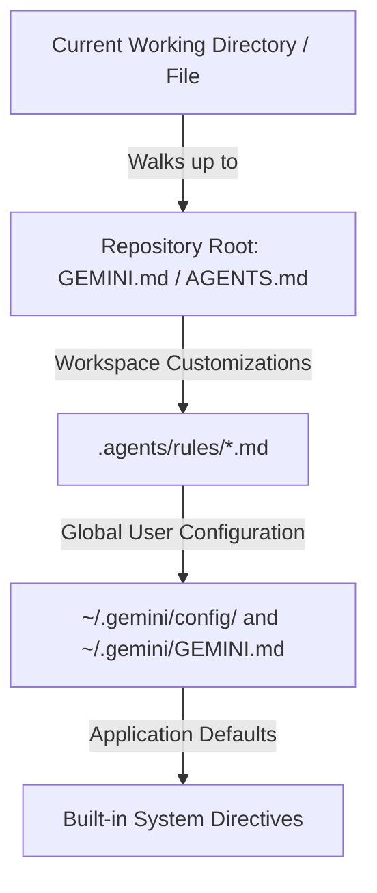

# Antigravity Rules & Directives Guide (`GEMINI.md` / `AGENTS.md`)

Google Antigravity allows users to customize agent behavior through Markdown directives and structured rulesets. This guide explains how Antigravity discovers, cascades, and prioritizes these directives across projects and workstations.

---

## 1. Discovery Hierarchy & Precedence

When an agent executes within a workspace, Antigravity discovers rules and directives from three primary sources:



### Loading Order (Highest to Lowest Priority):
1. **Workspace Project Rules**: Discovered hierarchically by walking up from the active file's directory to the repository root (e.g., folder containing `.git`).
2. **Contextual Rules (`.agents/rules/*.md`)**: Rules with specific activation triggers (e.g., `trigger: always_on` or `trigger: model_decision`).
3. **Global User Directives (`~/.gemini/GEMINI.md`, `~/.gemini/config/`)**: Machine-wide baseline directives that apply across all projects.
4. **Built-in System Prompts**: Default platform persona and system instructions.

---

## 2. Rule Types & Syntax

### A. Flat Directives (`GEMINI.md` / `AGENTS.md`)
- **Scope**: Directory-wide (applies to the directory and all descendants).
- **Format**: Pure Markdown without YAML frontmatter.
- **Deduplication**: Antigravity automatically deduplicates rules by resolved canonical file paths. Even if a rule is inherited through multiple directory paths, it is injected only once per turn.
- **Compatibility**: Antigravity treats `GEMINI.md` and `AGENTS.md` interchangeably. Creating a symlink `AGENTS.md -> GEMINI.md` ensures compatibility across agentic tooling.

### B. Contextual Rules (`.agents/rules/*.md`)
- **Scope**: On-demand or triggered by specific files.
- **Format**: Markdown with YAML frontmatter:
  ```markdown
  ---
  trigger: model_decision
  description: Safety guidelines when executing bash scripts.
  ---

  # Guidelines...
  ```
- **Triggers**:
  - `always_on`: Injected unconditionally into every turn.
  - `model_decision`: Progressive disclosure—only the name and description are in context until the model decides to activate the full rule.

---

## 3. Recommended Multi-Machine Strategy

1. **Global Baseline**:
   Deploy the canonical developer guidelines to `~/.gemini/GEMINI.md` using:
   ```bash
   agentkit apply
   ```
   This ensures that any scratch folder, ad-hoc terminal session, or unmanaged directory inherits Cooper Wallace's core engineering principles (Conventional Commits, bash safety, dynamic paths).

2. **Project Scaffolding**:
   When creating or standardizing a repository, scaffold a project-specific `GEMINI.md`:
   ```bash
   agentkit template --name my-repo --lang Python --test "pytest"
   ```
   This provides architecture maps, local test commands, and project constraints tailored to that specific repository.
