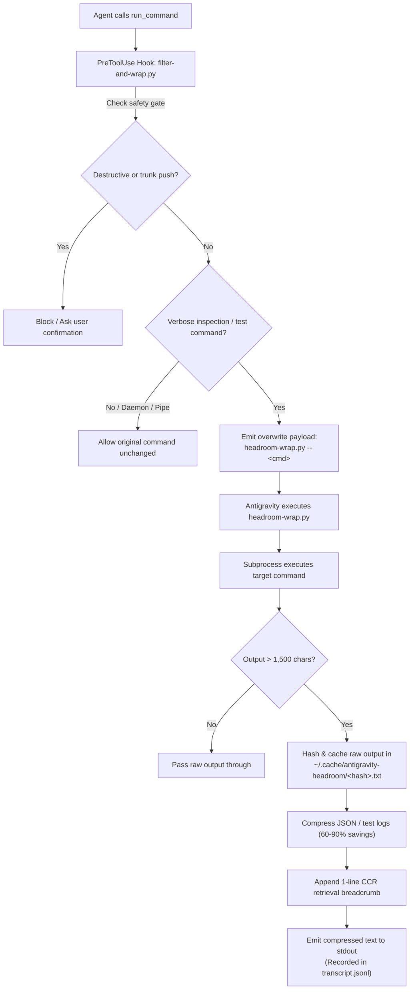

# Antigravity Plugins & Lifecycle Hooks Guide

This guide details the architecture of Antigravity **Plugins** and **Lifecycle Hooks**, provides templates for creating them, and outlines standard plugins, lifecycle hooks, and advanced execution patterns recommended across developer workstations.

---

## 1. Overview & Concepts

| Concept | File / Manifest | Purpose | Trigger / Lifecycle Point |
| :--- | :--- | :--- | :--- |
| **Lifecycle Hooks** | `.agents/hooks.json` | Runs arbitrary shell commands at agent loop milestones. | `PreInvocation`, `PostInvocation`, `PreToolUse`, `PostToolUse`, `Stop` |
| **Plugins** | `.agents/plugins/<name>/plugin.json` | Self-contained bundles uniting rules, skills, hooks, and MCP servers. | Loaded on workspace launch; toggleable via `agy plugin {enable,disable}`. |
| **Plugin Registry** | `plugins.json` | Explicit registration of external plugin directories. | Loaded globally (`~/.gemini/config/`) or locally (`.agents/`). |

---

## 2. Standard Lifecycle Hooks

The following lifecycle hooks represent core automation and safety components implemented across workstations:

### A. PreToolUse Subagent Delegation Guard
- **Lifecycle Event**: `PreToolUse` matching `edit_file|write_file`
- **Script**: `scripts/guard-subagent-delegation.sh`
- **Purpose**: Enforces cognitive tiering by blocking the Root Orchestrator (Gemini 4 Argon) from directly editing project code, tests, or UI files, ensuring implementation work is delegated to Gemini 3.8 Flash subagents.

### B. PreToolUse Git & Filesystem Safety Gate
- **Lifecycle Event**: `PreToolUse` matching `run_command`
- **Script**: `scripts/guard-git-operations.sh`
- **Purpose**: A deterministic programmatic circuit-breaker blocking direct pushes, force-pushes, or merges to `main`/`master`, while prompting for human confirmation on destructive commands (`rm -rf`, `mkfs`, `dd`).

### C. Stop Quality & Completion Gate
- **Lifecycle Event**: `Stop`
- **Script**: `scripts/verify-clean-completion.sh`
- **Purpose**: Intercepts agent loop termination. Rejects completion if automated test suites fail or if uncommitted changes linger in the git working tree.

### D. PostToolUse Auto-Formatter & Linter
- **Lifecycle Event**: `PostToolUse` matching `write_to_file|edit_file`
- **Purpose**: Automatically runs fast language formatters (e.g., `ruff format` on `.py`, `prettier` on `.ts/.json`, `gofmt` on `.go`) immediately after the agent writes or modifies a file.

### E. PreInvocation Git Hygiene Watcher
- **Lifecycle Event**: `PreInvocation`
- **Purpose**: Runs `git status --porcelain` at the start of an agent turn. If unstaged scratch files or a detached `HEAD` state are detected, it surfaces a concise alert in the agent's context.

---

## 3. The `PreToolUse` Overwrite Pattern for Output Token Compression

### Why `PreToolUse` Command Wrapping is Required

In autonomous coding loops, verbose commands (such as full test suite executions via `pytest` or `npm test`, voluminous `git diff` outputs, package listings, and directory trees) can emit tens of thousands of tokens per turn into `transcript.jsonl`. This rapidly exhausts the LLM context window and forces premature compaction.

Standard compression approaches fail in Antigravity CLI due to two hard constraints:
1. **`PostToolUse` Hook Immutability**: Under Antigravity's lifecycle contract, `PostToolUse` handlers can only return `{}` on stdout. They can trigger asynchronous notifications or logging, but they **cannot mutate, truncate, or rewrite** the tool output buffer after execution has completed.
2. **Network Proxy Incompatibility**: External HTTP/REST proxy layers (e.g., `headroom proxy --port 8787`) are incompatible with Antigravity's native Google Gemini backend transport, authentication channels, and internal RPC protocols.

### The Solution: Transparent `PreToolUse` Overwrite

To achieve token compression without violating Antigravity's lifecycle constraints, `antigravity-standardise` employs the **`PreToolUse` `overwrite` pattern** via `scripts/filter-and-wrap.py` and `scripts/headroom-wrap.py`:



### Hook Protocol & Overwrite Payload

When a candidate command is intercepted, `filter-and-wrap.py` returns an `overwrite` JSON payload on stdout:

```json
{
  "decision": "allow",
  "overwrite": {
    "CommandLine": "python3 ~/.gemini/config/plugins/autonomous-orchestrator/scripts/headroom-wrap.py -- pytest tests -v"
  }
}
```

### Reversible CCR (Contextual Compression with Retrieval)

`headroom-wrap.py` enforces **Reversible CCR**:
- **Exit Status Preservation**: Captures standard output and standard error while deterministically preserving `proc.returncode` (`sys.exit(proc.returncode)`).
- **Local Disk Cache**: Outputs exceeding `COMPRESSION_THRESHOLD` (default 1,500 chars) are hashed (`SHA-256[:12]`) and stored at `~/.cache/antigravity-headroom/<hash>.txt` with automatic LRU pruning (capped at 100 cache files).
- **Content-Aware Compression**: Employs `headroom-ai` (if installed) or deterministic built-in engines (`JSON SmartCrusher` and `LogCrusher`) to collapse repetitive passing lines and schema padding while preserving all failure tracebacks.
- **Retrieval Breadcrumb**: Appends a clear reference line:
  ```text
  [Headroom CCR: compressed 14,200 -> 1,850 chars (87% saved). Full output cached at ~/.cache/antigravity-headroom/a1b2c3d4e5f6.txt]
  ```
  Any agent requiring the full unabridged output can simply read the cached file with native `read_file`.

---

## 4. Potential Standard Plugins (Recommendations)

The following modular plugins can be bundled into `antigravity-standardise` and registered across workstations:

### 1. `rko-workstation-companion`
- **Purpose**: Integrates Antigravity with Cooper Wallace's Kubuntu rice ([`riced-kubuntu-os`](file:///home/cooper/Projects/riced-kubuntu-os)).
- **Components**:
  - **Skills**: `snapshot-plasma` (sanitizes and exports KDE Plasma 6 configs), `audit-packages` (diffs manual apt/flatpak installs against manifests).
  - **Rules**: OS baseline specifications (Kubuntu 26.04 LTS, KDE Plasma 6, Wayland).
  - **Hooks**: Auto-verifies dotfile symlink integrity after workstation provisioning.

### 2. `gh-devops-governance`
- **Purpose**: Integrates Antigravity with repository DevOps standards ([`gh-standardise`](file:///home/cooper/Projects/gh-standardise)).
- **Components**:
  - **Skills**: `audit-repo-standards` (runs `gh-standardise audit` on active workspace), `configure-ruleset` (applies GitHub branch protection).
  - **Rules**: Conventional Commits specification rules, PR title formatting guidelines.
  - **Hooks**: `PreToolUse` check ensuring branches follow `feat/`, `fix/`, `docs/`, `refactor/` naming conventions.

### 3. `developer-safety-kit`
- **Purpose**: Comprehensive workstation defense-in-depth bundle.
- **Components**:
  - **Rules**: Strict dynamic path enforcement, forbidden disk commands.
  - **Hooks**: Pre-command safety gate.
  - **MCP Server**: Sandboxed terminal runner or credential leak scanner (checking for `.env` or API tokens).

---

## 5. Templates Available in this Repository

This repository includes ready-to-use templates for future implementation:

1. [`templates/hooks.json`](../templates/hooks.json): Sample lifecycle hooks with `command-safety-guard`, `code-linter-formatter`, and `git-hygiene-reminder` pre-configured (disabled by default).
2. [`templates/plugins.json`](../templates/plugins.json): Standard schema for registering plugin search paths.
3. [`templates/plugin/`](../templates/plugin/): Complete plugin directory archetype containing:
   - `plugin.json`: Plugin metadata manifest
   - `hooks.json`: Plugin-scoped lifecycle hooks
   - `mcp_config.json`: MCP server configuration
   - `rules/AGENTS.md`: Plugin rules
   - `skills/sample-skill/SKILL.md`: Procedural skill runbook

---

## 6. Activating a Plugin or Hook

When you are ready to implement a specific plugin or hook:

### To activate a project hook:
```bash
cp ~/Projects/antigravity-standardise/templates/hooks.json .agents/hooks.json
# Edit .agents/hooks.json to set "enabled": true for desired hooks
```

### To scaffold a new plugin:
```bash
cp -r ~/Projects/antigravity-standardise/templates/plugin .agents/plugins/my-custom-plugin
# Edit .agents/plugins/my-custom-plugin/plugin.json and set "disabled": false
```
