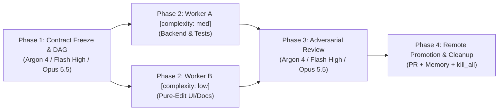

# Autonomous Multi-Model Lifecycle Runbook

This skill teaches the Root Orchestrator (Gemini 4 Argon, Gemini 3.8 Flash High, Claude Opus 5.5, or Claude Sonnet 3.7) how to execute features autonomously under Auto mode without human micro-management, while guaranteeing zero trunk contamination, quota headroom awareness, and rigorous adversarial verification.

---

## The 4-Phase Lifecycle



### Phase 1: Contract Freeze & Task DAG (Root Orchestrator)
1. **Analyze Requirements & Cross-Repo Context**:
   - Query the `memory` MCP knowledge graph for relevant cross-repo contracts, shared schemas, and system boundaries across the 4-layer workstation stack (`riced-kubuntu-os`, `workstation-setup`, `agentkit` [CLI `agentkit`], `repokit`).
   - When inspecting sibling repositories, use `repomix` AST compression (`repomix` MCP or `repomix --compress`) to retrieve structural skeletons without bloating context.
   - Inspect local project files, existing tests, and architecture constraints.
2. **Quota Headroom Pre-Check**:
   - Run `agentkit quota status` before freezing large DAG fan-outs to ensure target quota groups (Gemini, Claude, Argon) have sufficient headroom (>15%).
3. **Draft Plan Artifact**: Create an executable markdown plan in the artifact directory (`brain/<conversation-id>/plan.md`).
   - Define exact files to modify.
   - Define test contracts and acceptance criteria.
   - Outline subtask DAG with explicit complexity tiers (`[complexity: low|med|high]`) for parallel worker execution.
4. **Branch Isolation**: Ensure the active branch is a short-lived feature branch (`feat/<name>` or `fix/<name>`).

### Phase 2: Autonomous Implementation (Worker Subagents)
1. **Strict Subagent Execution**: ALL code, test, and UI edits (including initial implementation as well as iterative tuning after user review feedback) must be executed by subagents (`Workspace: "inherit"` or `"share"`), never directly by the Root Orchestrator (Argon 4 / Flash High / Opus 5.5 / Sonnet 3.7) in the root session.
2. **Complexity-Aware Model Tiering**:
   - **`low`**: Launch with `Model: "flash_lite"` (file moves/renames, mechanical find-replace, formatting, doc typos, simple one-command inspection).
   - **`med`**: Launch with `Model: "flash"` (feature code, tests, localized refactors).
   - **`high`**: Launch with `Model: "flash"` (cross-module refactors, complex debugging, security), with escalation to `Model: "pro"` (Gemini 4 Argon) for architecture, multi-repo design, or adversarial review when Argon quota is healthy (>15%).
   - Prefix every subagent prompt with the complexity tag: `[complexity: low|med|high]`.
3. **Automated Fallback & Wrap-Up Protection**:
   - `quota-guardian` automatically monitors quota via `RetrieveUserQuotaSummary` and reroutes subagents to healthy fallback groups if a group drops below 15%.
   - If all quota groups drop below 5%, `quota-guardian` denies further subagent delegation with `QUOTA WRAP-UP:`. Follow the graceful wrap-up protocol immediately (stop delegation, run tests, commit WIP, write `handoff.md`, advise user of reset time).
4. **Disjoint-File Parallel Worker Pool**: Split the Phase 1 DAG into parallel subagents partitioned by file domain (e.g., Worker A: Backend & Unit Tests; Worker B: Frontend/UI; Worker C: Architecture Docs) so workers execute in parallel without write contention.
5. **Automated Tool Output Token Suppression (Headroom CCR)**:
   - Note that `PreToolUse` automatically intercepts and wraps verbose test/inspection commands via `headroom-wrap.py` (`filter-and-wrap.py` -> `headroom-wrap.py`), compressing outputs >= 1,500 chars by 60-90%.
   - Full uncompressed outputs are cached locally at `~/.cache/antigravity-headroom/<hash>.txt` for reversible CCR retrieval via `read_file` when specific stack trace slices are required.
6. **Launch Worker Subagents**: Delegate coding and testing using `invoke_subagent`:
   - Set `Workspace: "share"` (or `"branch"`) when inside a Git repository root, or `Workspace: "inherit"` with strict disjoint file boundaries when the active session workspace is `$HOME`.
   - Pass the exact spec contract from Phase 1.
7. **Zero-Prompt Subagent Prompting**: Include explicit autonomy constraints in every `invoke_subagent` prompt:
   - **Pure-Edit Workers**: For workers modifying code, UI, or documentation without running tests/commands: *"Use ONLY `read_file` and `edit_file`. NEVER call `run_command`."*
   - **Test/Build Workers**: For workers running tests or build commands: *"Prioritize workspace-relative generic commands (`.venv/bin/pytest tests -v`, `git status`, `git diff`) when inside the repo root. Never use `cd ... && ...`, shell chains (`&&`, `;`, `|`), or `/path/to/.venv/bin/python3 -c ...` one-liners. Reserve absolute or `-C` paths only when cross-directory invocations from `$HOME` are required."*
   - Instruct workers: *"Return only a concise 10-line summary of files modified and verification results."*
8. **Reactive Wakeup**: When the subagents complete, the agent harness reactively resumes the Root Orchestrator.

### Phase 3: Adversarial Critique & Self-Healing (Argon 4 / Flash High / Opus 5.5)
1. **Inspect Git Diff**:
   - Run `git status` and `git diff` to view the comprehensive changes.
2. **Audit Checkpoints**:
   - Review logic against edge cases, error handling, and potential race conditions.
   - Verify that no secrets, `.env` files, or temporary scratch statements leaked.
   - Verify that commit messages comply with Conventional Commits 1.0.0.
3. **Self-Healing & User Review Feedback Loop**: When either the adversarial review OR the user reports a regression, tuning issue, or requested adjustment: the Root Orchestrator diagnoses the logs/diff and updates `plan.md`, but **MUST dispatch a subagent (`Model: "flash"`)** to implement the fix and update unit tests — never editing project files directly in the root session.

### Phase 4: Verification, Memory Sync & PR Promotion Gate
1. **Deterministic Quality Gate**: Verify that the test suite passes locally. The `Stop` hook will reject session termination if tests fail or if the worktree is dirty.
2. **Knowledge Graph Persistence**: Persist newly established cross-repo architectural contracts, entity relationships, shared schemas, or invariants to the `memory` MCP knowledge graph so future sessions and sibling repos maintain alignment.
3. **Subagent Pool Cleanup**: Terminate all idle worker subagents via `manage_subagents(Action="kill_all")` before finalizing the session.
4. **Push Feature Branch**:
   ```bash
   git push -u origin feat/<feature-name>
   ```
5. **Create Pull Request**:
   Use the GitHub CLI (`gh pr create`) or GitHub MCP to open a PR:
   ```bash
   gh pr create --title "feat(scope): concise description" \
                --body "### Summary... ### Verification..."
   ```
6. **Trunk Promotion**: Let GitHub CI quality gates and `repokit` rulesets govern the Squash and Merge into `main`.
