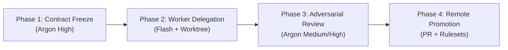

# Autonomous Multi-Model Lifecycle Runbook

This skill teaches the Root Orchestrator how to execute features autonomously under Auto mode without human micro-management, while guaranteeing zero trunk contamination and rigorous adversarial verification.

---

## The 4-Phase Lifecycle



### Phase 1: Contract Freeze & Task DAG (Argon High)
1. **Analyze Requirements**: Inspect relevant files, existing tests, and architecture constraints.
2. **Draft Plan Artifact**: Create an executable markdown plan in the artifact directory (`brain/<conversation-id>/plan.md`).
   - Define exact files to modify.
   - Define test contracts and acceptance criteria.
   - Outline subtask DAG for parallel worker execution.
3. **Branch Isolation**: Ensure the active branch is a short-lived feature branch (`feat/<name>` or `fix/<name>`).

### Phase 2: Autonomous Implementation (Gemini 3.8 Flash)
1. **Launch Worker Subagents**: Delegate coding and testing to subagents using `invoke_subagent`:
   - Set `Model: "flash"` for maximum throughput and low token overhead.
   - Set `Workspace: "share"` (or `"branch"`) to isolate changes in independent Git worktrees.
   - Pass the exact spec contract from Phase 1.
2. **Subagent Execution Rule**:
   - Instruct the worker: *"Implement the requirements test-first. Run pytest/npm test until 100% green. Return only a concise 10-line summary of files modified and test output."*
3. **Reactive Wakeup**: When the subagents complete, Antigravity reactively resumes the Root Orchestrator.

### Phase 3: Adversarial Critique & Self-Healing (Gemini 4 Argon)
1. **Inspect Git Diff**:
   - Run `git status` and `git diff` to view the comprehensive changes.
2. **Audit Checkpoints**:
   - Review logic against edge cases, error handling, and potential race conditions.
   - Verify that no secrets, `.env` files, or temporary scratch statements leaked.
   - Verify that commit messages comply with Conventional Commits 1.0.0.
3. **Self-Healing Loop**: If defects are discovered, re-dispatch the Flash subagent with specific diff line pointers and error logs until resolved.

### Phase 4: Verification & PR Promotion Gate
1. **Deterministic Quality Gate**: Verify that the test suite passes locally. The `Stop` hook will reject session termination if tests fail or if the worktree is dirty.
2. **Push Feature Branch**:
   ```bash
   git push -u origin feat/<feature-name>
   ```
3. **Create Pull Request**:
   Use the GitHub CLI (`gh pr create`) or GitHub MCP to open a PR:
   ```bash
   gh pr create --title "feat(scope): concise description" \
                --body "### Summary... ### Verification..."
   ```
4. **Trunk Promotion**: Let GitHub CI quality gates and Rulesets govern the Squash and Merge into `main`.
