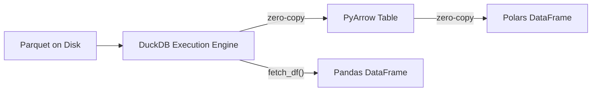

# DuckDB Columnar Pipeline & Lakehouse Standards

This skill defines best practices for utilizing DuckDB as an embedded, in-process analytical execution engine for local Parquet data lakes, feature stores, and zero-copy data science workflows.

---

## 1. Direct Parquet Data Lake Querying

DuckDB operates directly against local and remote Parquet files without requiring pre-loading or database ingestion.

### Partitioned & Glob Queries
Query hundreds of partitioned Parquet files with automatic partition pruning:
```sql
-- Read partitioned historical bars or box scores
SELECT 
    symbol,
    date_trunc('day', timestamp) AS trade_date,
    SUM(volume) AS daily_vol,
    AVG(close) AS avg_close
FROM read_parquet('data/lake/bars/year=*/*/*.parquet', hive_partitioning = true)
WHERE year >= '2023' 
  AND symbol IN ('AAPL', 'MSFT', 'NVDA')
GROUP BY 1, 2
ORDER BY 1, 2;
```

### Projection & Filter Pushdown
DuckDB pushes projections (column selection) and filters (WHERE clauses) directly into Parquet metadata:
- Only required row groups and column chunks are decompressed from disk.
- Never use `SELECT *` on wide analytical schemas; request explicit columns to maximize I/O efficiency.

---

## 2. Memory Optimization & Resource Constraints

In local or containerized agent environments, unconstrained queries can cause system Out-Of-Memory (OOM) crashes. Enforce hard operational limits at connection initialization:

```python
import duckdb

def get_optimized_duckdb_connection(db_path: str = ":memory:", max_memory: str = "4GB", threads: int = 4, temp_dir: str = "/tmp/duckdb_spill") -> duckdb.DuckDBPyConnection:
    con = duckdb.connect(db_path)
    
    # Enforce strict memory headroom
    con.execute(f"PRAGMA memory_limit = '{max_memory}'")
    
    # Configure thread concurrency
    con.execute(f"PRAGMA threads = {threads}")
    
    # Enable disk spilling for out-of-core operations larger than RAM
    con.execute(f"PRAGMA temp_directory = '{temp_dir}'")
    
    # Enable progress reporting for long-running aggregations
    con.execute("PRAGMA enable_progress_bar = true")
    
    return con
```

*Rule*: Always provide a dedicated, fast-disk `temp_directory` when sorting or grouping datasets that exceed system RAM.

---

## 3. Zero-Copy Integration (Arrow, Polars, Pandas)

DuckDB implements the Apache Arrow C Data Interface, allowing zero-copy sharing of memory buffers across analytical tools.



### Zero-Copy Arrow & Polars Workflow
```python
import polars as pl
import pyarrow as pa

con = duckdb.connect()

# 1. Query Parquet directly to PyArrow Table (Zero-Copy)
arrow_table: pa.Table = con.execute("""
    SELECT timestamp, player_id, score, rolling_avg
    FROM read_parquet('data/seasons/*.parquet')
    WHERE season = 2024
""").arrow()

# 2. Ingest Arrow Table into Polars with zero data duplication
df_polars = pl.from_arrow(arrow_table)

# 3. Register Polars / PyArrow back into DuckDB for fast ad-hoc SQL
con.register("current_slice", arrow_table)
summary = con.execute("SELECT player_id, AVG(score) FROM current_slice GROUP BY 1").fetch_df()
```

---

## 4. Views, Materialized Tables & Incremental Appending

### Ephemeral Views vs Materialized Tables
- **Views**: Use for lightweight query abstractions and schema normalization over raw Parquet files without disk duplication:
  ```sql
  CREATE OR REPLACE VIEW v_clean_bars AS 
  SELECT 
      CAST(timestamp AS TIMESTAMP) AS ts,
      symbol,
      open, high, low, close,
      volume,
      filename AS source_file
  FROM read_parquet('data/raw_bars/*.parquet', filename=true);
  ```
- **Materialized Parquet Exports**: Use for persistent feature caches:
  ```sql
  COPY (
      SELECT * FROM v_engineered_features WHERE ts >= '2024-01-01'
  ) TO 'data/features/features_2024.parquet' (FORMAT PARQUET, COMPRESSION ZSTD);
  ```

### Idempotent Incremental Ingestion Pattern
Ingest incoming updates without duplicating rows:
```python
def incremental_upsert_parquet(con: duckdb.DuckDBPyConnection, incoming_parquet: str, target_table: str, key_columns: list[str]):
    """Idempotently insert or update rows from incoming Parquet into DuckDB table."""
    key_join = " AND ".join([f"t.{k} = s.{k}" for k in key_columns])
    
    con.execute(f"""
        CREATE TABLE IF NOT EXISTS {target_table} AS 
        SELECT * FROM read_parquet('{incoming_parquet}') WHERE 1=0;
    """)
    
    con.execute(f"""
        -- Remove conflicting keys prior to insertion
        DELETE FROM {target_table} AS t
        USING read_parquet('{incoming_parquet}') AS s
        WHERE {key_join};
        
        -- Insert fresh records
        INSERT INTO {target_table}
        SELECT * FROM read_parquet('{incoming_parquet}');
    """)
```

---

## 5. Schema Lineage & Metadata Evolution

Parquet schemas can drift over time as upstream data providers add, rename, or cast columns.

### Lineage Auditing Queries
1. **Source Tracking with `filename=true`**:
   Extract exact source file origin alongside every query result to locate corrupted or anomalous data batches:
   ```sql
   SELECT filename, count(*), min(timestamp), max(timestamp)
   FROM read_parquet('data/lake/**/*.parquet', filename=true)
   GROUP BY filename;
   ```
2. **Schema Reconciliation (`union_by_name`)**:
   When files have differing column orders or new columns added over time, set `union_by_name = true`:
   ```sql
   SELECT * FROM read_parquet('data/lake/**/*.parquet', union_by_name=true);
   ```
3. **Column Type Verification**:
   ```sql
   PRAGMA table_info('v_clean_bars');
   ```
