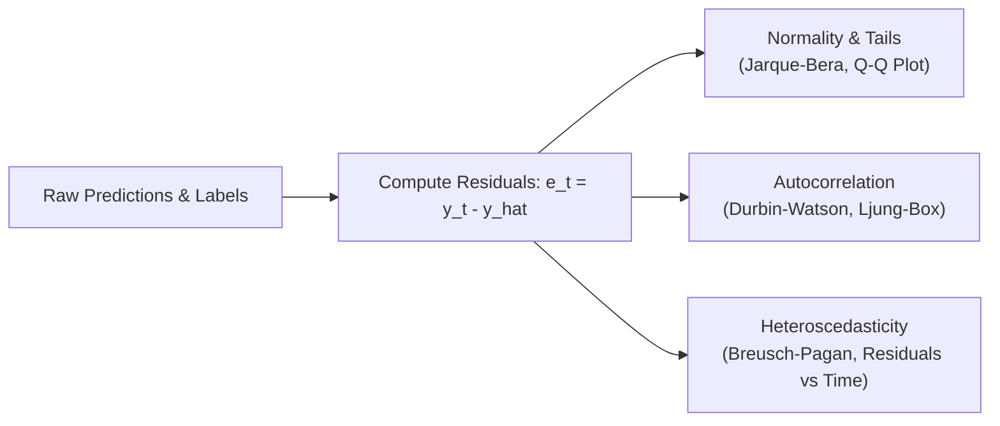

# Model Evaluation, Diagnostics & Explainability

This skill defines rigorous evaluation standards, loss function alignment, residual auditing, and model explainability architectures for production machine learning systems.

---

## 1. Metric Selection Taxonomy

Selecting inappropriate metrics creates a dangerous disconnect between offline optimization and real-world utility. Standard metrics (like raw classification accuracy or root mean square error) frequently fail under class imbalance and sequential dependencies.

### Metric Selection Decision Matrix

| Problem Type | Primary Metric | Secondary / Diagnostic Metric | Unsuitable / Misleading Metric |
| :--- | :--- | :--- | :--- |
| **Imbalanced Classification** | **PR-AUC** (Average Precision) | **Brier Score** / Expected Calibration Error (ECE) | ROC-AUC, Raw Accuracy |
| **Ranking / Top-$K$ Selection** | **NDCG@K**, Precision@$K$ | Mean Reciprocal Rank (MRR) | Macro F1, Binary Log-Loss |
| **Directional Forecasting** | **Directional Accuracy** (Hit Rate) | Profit Factor, Information Coefficient (IC) | RMSE, MAE |
| **Financial / Economic Strategy** | **Sharpe / Sortino Ratio**, Max Drawdown | Calmar Ratio, Slippage-Adjusted PnL | Raw Return, Accuracy |
| **Continuous Target** | **MAE** (or Huber Loss) | Mean Absolute Scaled Error (MASE) | $R^2$ on non-stationary levels |

---

## 2. Key Metrics & Deep Dives

### PR-AUC vs ROC-AUC in Rare Event Detection
When positive events are rare ($< 5\%$, e.g., market regime breaks, rare player injuries, severe drawdowns):
- **ROC-AUC** is evaluated on True Positive Rate vs False Positive Rate ($FPR = \frac{FP}{FP + TN}$). Because True Negatives dominate, the denominator is enormous, keeping $FPR$ artificially low and producing deceptively optimistic ROC-AUC scores (e.g., 0.95).
- **PR-AUC (Average Precision)** evaluates Precision ($\frac{TP}{TP + FP}$) vs Recall ($\frac{TP}{TP + FN}$). It directly penalizes false positive alerts without dilution from large negative pools.

```python
from sklearn.metrics import precision_recall_curve, auc, average_precision_score, brier_score_loss

def evaluate_imbalanced_classifier(y_true, y_prob) -> dict:
    prec, rec, _ = precision_recall_curve(y_true, y_prob)
    pr_auc = auc(rec, prec)
    ap = average_precision_score(y_true, y_prob)
    brier = brier_score_loss(y_true, y_prob)
    return {
        'pr_auc': pr_auc,
        'average_precision': ap,
        'brier_score': brier  # Closer to 0 indicates superior calibration
    }
```

### Probabilistic Calibration: Brier Score & ECE
A probability prediction of 0.80 must materialize as positive 80% of the time.
- **Brier Score**: Mean squared difference between predicted probability and actual binary outcome:
  $$\text{Brier} = \frac{1}{N}\sum_{i=1}^N (p_i - y_i)^2$$
- Calibrate probabilities using Platt Scaling (`CalibratedClassifierCV(method='sigmoid')`) or Isotonic Regression (`method='isotonic'`).

### Financial & Strategy Metrics
Evaluate predictions translated into simulated economic decisions:
- **Directional Accuracy (Hit Rate)**:
  $$\text{DA} = \frac{1}{N}\sum_{t=1}^N \mathbb{I}(\operatorname{sgn}(\hat{y}_t) == \operatorname{sgn}(y_t))$$
- **Annualized Sharpe Ratio**:
  $$\text{Sharpe} = \sqrt{252} \cdot \frac{\operatorname{mean}(R_t)}{\operatorname{std}(R_t)}$$
- **Sortino Ratio**: Penalizes only downside volatility ($\sigma_{\text{downside}}$).
- **Profit Factor**: Ratio of gross profits to gross losses:
  $$\text{Profit Factor} = \frac{\sum \max(0, R_t)}{\sum |\min(0, R_t)|}$$

---

## 3. Residual Distribution & Diagnostic Audits

Models that leave systematic structure in their residuals have failed to capture available signal. Run diagnostic checks on $e_t = y_t - \hat{y}_t$:



```python
import scipy.stats as stats
from statsmodels.stats.stattools import durbin_watson
from statsmodels.stats.diagnostic import acorr_ljungbox

def audit_residuals(residuals: pd.Series) -> dict:
    clean_res = residuals.dropna()
    dw = durbin_watson(clean_res)  # Values close to 2.0 indicate zero 1st-order autocorrelation
    lb_test = acorr_ljungbox(clean_res, lags=[5, 10, 20], return_df=True)
    jb_stat, jb_pval = stats.jarque_bera(clean_res)
    
    return {
        'durbin_watson': dw,
        'has_first_order_autocorr': abs(dw - 2.0) > 0.4,
        'ljung_box_pvalues': lb_test['lb_pvalue'].to_dict(),
        'jarque_bera_pvalue': jb_pval,
        'is_normal': jb_pval > 0.05
    }
```

*Rule*: If Durbin-Watson is substantially $< 1.5$ or $> 2.5$, residuals are autocorrelated; lag features or seasonal autoregressive terms must be added.

---

## 4. Model Explainability: SHAP & LIME

Black-box models require interpretable auditing before capital or competitive deployment.

### TreeSHAP for Tree Ensembles (XGBoost, LightGBM, CatBoost)
TreeSHAP computes exact Shapley values in polynomial time:
- **Global Importance**: Mean absolute SHAP value $\frac{1}{N}\sum | \phi_i |$
- **Directional Impact (Beeswarm)**: Shows whether high feature values drive predictions up or down.
- **Feature Interactions**: Computes exact pairwise interaction matrices $\phi_{i, j}$.

```python
import shap

def explain_tree_model(model, X_sample: pd.DataFrame):
    explainer = shap.TreeExplainer(model)
    shap_values = explainer(X_sample)
    
    # 1. Global feature importance ranking
    importance_df = pd.DataFrame({
        'feature': X_sample.columns,
        'mean_abs_shap': np.abs(shap_values.values).mean(axis=0)
    }).sort_values('mean_abs_shap', ascending=False)
    
    return explainer, shap_values, importance_df
```

### LIME for Model-Agnostic Local Explanations
Use LIME (Local Interpretable Model-agnostic Explanations) to explain individual anomalous inferences or high-stakes trade decisions by fitting a local linear surrogate model around the perturbed instance.

---

## 5. Subpopulation, Cohort & Error Slice Analysis

Aggregated metrics across the entire dataset can hide critical failure modes in specific subsets.

### Slice Diagnostics Framework
1. **Temporal Cohort Slicing**:
   Evaluate metrics across rolling monthly or quarterly slices to detect performance degradation over time (concept drift / regime shifts).
2. **Subpopulation Slicing**:
   - For financial bars: Slice by market volatility regime (Low Vol vs High Vol vs Crisis Spike).
   - For sports/player analytics: Slice by player age bracket, position, game context (home vs away, back-to-back games).
3. **Worst-Case Outlier Post-Mortem**:
   Extract the top 1% worst prediction errors:
   - Identify whether failures are caused by bad data (spurious spikes), structural shocks (unexpected news/injuries), or feature extrapolation outside training support.

```python
def slice_performance_by_regime(df: pd.DataFrame, y_true_col: str, y_pred_col: str, regime_col: str):
    """Compute error metrics segmented by operational regime."""
    results = {}
    for regime, group in df.groupby(regime_col):
        mae = (group[y_true_col] - group[y_pred_col]).abs().mean()
        hit_rate = (np.sign(group[y_true_col]) == np.sign(group[y_pred_col])).mean()
        results[regime] = {
            'count': len(group),
            'mae': mae,
            'hit_rate': hit_rate
        }
    return pd.DataFrame(results).T
```
