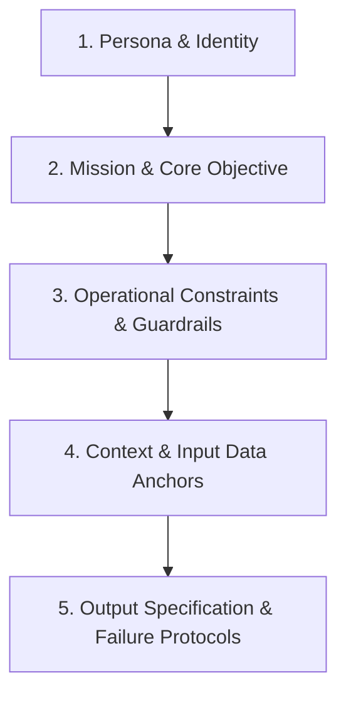

# Prompt Engineering & System Instruction Architecture

This skill provides engineering standards for drafting production system prompts, optimizing in-context reasoning, eliminating hallucinations, minimizing token latency, and implementing automated prompt regression testing.

---

## 1. System Prompt Anatomy (The 5-Part Modular Framework)

Production system instructions should avoid unstructured, conversational text. Instead, organize prompts into five distinct structural components:



### 1. Persona & Identity
- Clear declaration of model role, domain expertise, and operational tone.
- *Example*: `"You are an adversarial risk auditor evaluating quantitative trading signals for institutional compliance."`

### 2. Mission & Core Objective
- Unambiguous statement of the primary outcome expected from the interaction.
- Keep the objective bounded and actionable.

### 3. Operational Constraints & Guardrails
- Hard boundaries on tool usage, data modifications, and prohibited operations.
- Explicit definition of safety gates (e.g., dry-run requirements, idempotent execution).

### 4. Input Anchors & Context Boundaries
- Explicit delimiters separating user instructions, contextual reference documents, and database schemas.
- Use XML-style tags (`<context>`, `<document>`, `<schema>`) to prevent prompt injection attacks.

### 5. Output Specification & Fallback Protocols
- Exact structure required (JSON, Markdown table, strictly defined code blocks).
- Behavior when input data is incomplete, ambiguous, or contradictory.

---

## 2. In-Context Reasoning & Chain-of-Thought (CoT)

Guiding the model's internal computation before generating final answers drastically improves accuracy on complex logical, financial, and code reasoning tasks.

### Scratchpad / Thought Enclosures
Require models to perform reasoning inside private tags before producing the public output:
```text
Before emitting your final decision, reason step-by-step inside <scratchpad> tags:
1. Identify all numerical variables and verify their units.
2. Check for conflicting dates or temporal inconsistencies.
3. Compute intermediate metrics and verify that assumptions hold.
</scratchpad>
After closing </scratchpad>, emit ONLY the final decision JSON.
```

### Few-Shot vs Zero-Shot with Step Guidance
- **Zero-Shot CoT** (`"Think step by step"`): Effective for generic reasoning, but produces variable output lengths and unpredictable formatting.
- **Few-Shot In-Context Learning**: Demonstrates both the reasoning sequence and the exact output syntax across 2-3 canonical examples. Highly recommended for domain-specific tasks (e.g., classifying baseball pitch trajectories or complex option trades).

---

## 3. Negative Constraints & Guardrail Psychology

LLMs process tokens sequentially; stating negative instructions poorly often induces the very behavior you seek to avoid (the "pink elephant" paradox).

### Best Practices for Negative Constraints
1. **Prefer Positive Directives**: Instead of *"Do not use print statements"*, specify *"Log all diagnostic output using the standard logging module with level DEBUG."*
2. **Pair Prohibitions with Safe Alternatives**:
   - *Weak*: *"Never execute git push on main."*
   - *Robust*: *"Direct pushes to main/master branches are strictly prohibited. Always create a short-lived feature branch (`feat/<name>`) and open a Pull Request."*
3. **Elevate Critical Rules to Dedicated Sections**: Group hard restrictions under a prominent `## STRICT OPERATIONAL CONSTRAINTS` heading rather than burying them in running text.

---

## 4. Context Window Optimization & Distillation

Monolithic context bloats token consumption, increases per-request latency, and introduces attention degradation ("lost in the middle").

### Distillation Strategies
- **XML Tag Structural Clarity**:
  ```xml
  <system_rules>
  ...
  </system_rules>

  <input_data type="parquet_schema">
  ...
  </input_data>
  ```
- **Structural AST Compression**: For code exploration, pass compressed class/function signatures (`repomix --compress` or AST skeletons) rather than full file contents.
- **Strip Conversational Filler**: Eliminate courteous preambles, verbose explanations, and boilerplate repetition in system messages. Every token in the system prompt is evaluated on every turn.

---

## 5. Hallucination Prevention & Factual Grounding

When models lack specific information, their generative nature encourages plausible-sounding fabrications.

### Grounding Safeguards
1. **Citation & Quote Requirement**:
   Require the model to quote the exact substring from the source document before extracting facts:
   ```text
   For every extracted financial metric, provide the exact verbatim quote from the text in the "evidence" field. If a metric cannot be backed by a verbatim quote, omit it.
   ```
2. **Explicit Fallback Tokens**:
   Explicitly authorize ignorance:
   ```text
   If the answer is not directly stated in or cannot be logically deduced from the provided <documents>, respond with "INSUFFICIENT_INFORMATION". Do not extrapolate or consult external knowledge.
   ```

---

## 6. Prompt Evaluation & Regression Testing Harness

Treat prompts with the same software engineering discipline as code: version-controlled, covered by test cases, and audited for regression.

```python
import unittest

class TestPromptRegression(unittest.TestCase):
    def setUp(self):
        self.golden_dataset = [
            {
                "input": "Q2 revenue was $5.4M with gross margins of 62%.",
                "expected_keys": ["revenue", "gross_margin"],
                "expected_values": {"revenue": 5400000.0, "gross_margin": 0.62}
            },
            {
                "input": "No financial results were discussed in the call.",
                "expected_keys": [],
                "expected_values": {}
            }
        ]
        
    def test_schema_adherence_and_accuracy(self):
        for case in self.golden_dataset:
            result = run_extraction_prompt(case["input"])
            for key in case["expected_keys"]:
                self.assertIn(key, result)
                self.assertEqual(result[key], case["expected_values"][key])
```
