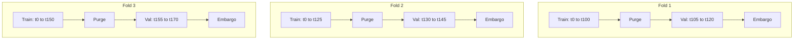

# Time-Series Machine Learning Production Guidelines

This skill defines rigorous methodologies for developing, validating, and deploying machine learning models on sequential and non-stationary time-series datasets. It codifies lessons from quantitative trading bars (AugursBazaar) and longitudinal player season analytics (AugursSaber).

---

## 1. Core Principles of Temporal Modeling

Time-series predictive modeling differs fundamentally from cross-sectional machine learning:
1. **Temporal Precedence**: Information flows in only one direction. Future data must never influence past feature calculations, transformations, scalers, or target labels.
2. **Non-Stationarity**: Data generating processes evolve across regimes (e.g., bull/bear market regimes, rule changes in sports, player aging curves). Models cannot assume independently and identically distributed (i.i.d.) observations.
3. **Serial Correlation**: Consecutive observations exhibit autoregressive dependency. Randomly shuffling rows destroys temporal structure and yields artificially deflated test error.

---

## 2. Eliminating Lookahead Bias

Lookahead bias (future data leakage) is the leading cause of backtest failure. Enforce the following zero-leakage protocols:

### Point-in-Time Joins ("As-Of" Semantics)
- When joining macro indicators, financial statements, or scouting reports, join using timestamp inequalities:
  $$\text{FeatureTimestamp} \le \text{ObservationTimestamp}$$
- Use backward "as-of" joins (`pd.merge_asof(..., direction='backward')` or DuckDB `ASOF JOIN`).
- Account for reporting delays (e.g., SEC 10-Q filing dates vs fiscal period ends; stat correction updates 24 hours post-game).

### Label Indexing vs Feature Indexing
- Features at time $t$ predict target at time $t + h$:
  $$y_{t+h} = f(X_t)$$
- Ensure features only utilize information up to timestamp $t$.
- Shift target labels backward during dataset construction:
  ```python
  # Correct: Feature at t predicts future target at t+h
  df['target_h1'] = df['close'].pct_change(1).shift(-1)
  # Features must only use current and past information
  df['feature_mom_5'] = df['close'].pct_change(5)
  ```

### State Leakage in Transformations
- Scalers, imputers, and encoders must be fitted **exclusively on the training fold** and applied via `transform()` to validation/test folds.
- Never fit a `StandardScaler`, `QuantileTransformer`, or target encoder on the entire dataset prior to splitting.

---

## 3. Walk-Forward Cross-Validation Methodology

Standard $K$-Fold cross-validation is strictly prohibited on time-series data because training on future bars to predict past bars leaks structural regime information.



### Window Paradigms
- **Expanding Window**: Training window begins at fixed $t_0$ and expands with each fold. Recommended when long-term historical regime patterns remain informative.
- **Rolling (Sliding) Window**: Training window maintains a fixed length $W$, dropping older historical bars. Recommended when historical data suffers from severe structural breaks.

### Purging and Embargoing
To prevent information leakage from overlapping labels and serial autocorrelation (Lopez de Prado methodology):
1. **Purge Window**: Drop training observations whose future prediction label overlaps with the start of the validation window.
   $$\text{Purge Size} \ge h \quad (\text{where } h \text{ is prediction horizon})$$
2. **Embargo Window**: Exclude a buffer of samples immediately following the validation set before the next training fold starts, dampening autoregressive memory effects.
   $$\text{Embargo Size} \approx 0.01 \times N \text{ to } 0.05 \times N$$

---

## 4. Stationarity Checks & Transformation

Non-stationary series with unit roots generate spurious correlations. All input features must be evaluated for stationarity.

### Statistical Tests
- **Augmented Dickey-Fuller (ADF) Test**:
  - $H_0$: Series contains a unit root (non-stationary).
  - $p < 0.05$: Reject $H_0$; series is stationary.
- **KPSS Test**:
  - $H_0$: Series is level- or trend-stationary.
  - $p > 0.05$: Fail to reject $H_0$; series is stationary.

```python
from statsmodels.tsa.stattools import adfuller, kpss

def audit_stationarity(series: pd.Series) -> dict:
    adf_res = adfuller(series.dropna(), autolag='AIC')
    kpss_res = kpss(series.dropna(), regression='c', nlags='auto')
    return {
        'adf_stat': adf_res[0],
        'adf_pvalue': adf_res[1],
        'is_adf_stationary': adf_res[1] < 0.05,
        'kpss_stat': kpss_res[0],
        'kpss_pvalue': kpss_res[1],
        'is_kpss_stationary': kpss_res[1] > 0.05,
    }
```

### Stationary Transformations
1. **Log Differencing**: $r_t = \ln(P_t) - \ln(P_{t-1})$
2. **Rolling Z-Score**: $z_t = \frac{x_t - \mu_{t, W}}{\sigma_{t, W}}$ (where $\mu, \sigma$ are computed with lookback $W$)
3. **Fractional Differentiation**: Preserves maximal memory (autocorrelation) while stripping unit roots. Choose minimum $d \in (0, 1)$ such that ADF $p < 0.05$.

---

## 5. Feature Generation for Sequential Data

### Lag Features & Acceleration
Generate historical lags of stationary transformations:
```python
def make_lag_features(df: pd.DataFrame, col: str, lags: list[int]) -> pd.DataFrame:
    result = pd.DataFrame(index=df.index)
    for lag in lags:
        result[f"{col}_lag_{lag}"] = df[col].shift(lag)
    # Velocity and Acceleration
    result[f"{col}_velocity"] = df[col] - df[col].shift(1)
    result[f"{col}_acceleration"] = result[f"{col}_velocity"] - result[f"{col}_velocity"].shift(1)
    return result
```

### Rolling & Exponential Statistics
- Always pass `min_periods` to prevent silent null bias.
- Rolling volatility: $\sigma_t = \sqrt{\frac{1}{W}\sum_{i=0}^{W-1} (r_{t-i} - \bar{r})^2}$
- Rolling skewness and kurtosis to capture fat-tail regime changes.
- Exponential Moving Average (EMA) with span or half-life parameter:
  $$\text{EMA}_t = \alpha x_t + (1 - \alpha) \text{EMA}_{t-1}, \quad \alpha = \frac{2}{\text{span} + 1}$$

---

## 6. Model Integration Patterns

### Gradient Boosted Trees (XGBoost / LightGBM)
1. **Time-Based Split Validation**:
   Pass a non-shuffled validation set from the latest chronological slice to `early_stopping_rounds`.
2. **Monotonic Constraints**:
   Enforce physical or economic domain logic (e.g., higher volume + price breakout implies positive probability direction).
3. **Sample Weighting by Recency**:
   Weight observations using exponential decay to prioritize recent structural regimes:
   $$w_t = e^{-\lambda (T - t)}$$

```python
import xgboost as xgb

def train_timeseries_xgb(X_train, y_train, X_val, y_val):
    dtrain = xgb.DMatrix(X_train, label=y_train)
    dval = xgb.DMatrix(X_val, label=y_val)
    
    params = {
        'objective': 'binary:logistic',
        'eval_metric': 'logloss',
        'max_depth': 4,
        'learning_rate': 0.03,
        'subsample': 0.8,
        'colsample_bytree': 0.8,
        'seed': 42
    }
    
    evals = [(dtrain, 'train'), (dval, 'val')]
    model = xgb.train(
        params,
        dtrain,
        num_boost_round=1000,
        evals=evals,
        early_stopping_rounds=30,
        verbose_eval=False
    )
    return model
```

### Prophet / NeuralProphet Integration
- Isolate low-frequency seasonal and trend components with Prophet.
- Feed Prophet trend/seasonality deltas as engineered features into XGBoost for high-frequency residual fitting.
- Never use future regressors unless they are deterministically known calendar events (e.g., market holidays, playoff schedules).

---

## 7. Operational Checklist & Anti-Patterns

| Anti-Pattern | Operational Risk | Production Requirement |
| :--- | :--- | :--- |
| Random $K$-Fold split | Catastrophic lookahead leakage; unrealistic offline metric | Use `WalkForwardSplitter` with purge and embargo |
| Global standard scaling | Leaks future mean and variance into training rows | Wrap all preprocessing in fold-aware pipeline |
| Fitting on raw prices/scores | Non-stationary drift breaks tree split thresholds | Transform to returns, rolling z-scores, or fractional diffs |
| Evaluating solely on Accuracy | Misleading on imbalanced financial bars / win states | Evaluate PR-AUC, Brier score, and Sharpe / PnL return |
| Unbounded `ffill()` | Propagates stale data across market shutdowns/off-seasons | Use `ffill(limit=K)` and add missingness indicator flag |
