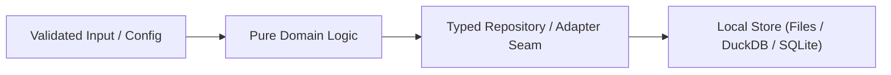

# Architecture & Design: {{PROJECT_NAME}}

> **Summary**: {{PROJECT_DESCRIPTION}}  
> **Primary Stack**: {{PRIMARY_LANGUAGE}}

## 1. Architecture Overview

Describe the high-level modular architecture (e.g., CLI/API entrypoint -> domain logic -> repository/persistence seam) and strict downward dependency direction.

## 2. Data Flow

## 3. Component Boundaries & Seams

- **Entrypoint / Transport (`src/`)**: Parses args/requests, validates startup invariants, delegates to domain services.
- **Domain Core (`src/`)**: Pure, deterministic transformations with zero direct filesystem or network coupling.
- **Persistence / External Seams (`src/`)**: Typed `Protocol` / interface isolating storage or external APIs so implementations swap cleanly between local and cloud environments.

## 4. Key Trade-Offs

- **Simplicity vs. Premature Abstraction**: Prefer standard library and single-process local execution first; introduce interfaces only at I/O boundaries.
- **Fail-Fast Validation**: Reject invalid schemas at boundaries rather than propagating partial/null state downstream.

## 5. Security & Privacy Boundaries

- Credentials loaded strictly from environment / untracked `.env`; never logged or serialized.
- Structured JSON logs enforce an explicit field allow-list.
- Dynamic path resolution only (`$HOME`, `Path.home()`); reject path traversal outside workspace/root boundaries.

## 6. Local-to-Cloud Parity

| Component | Local Implementation | Cloud Target | Boundary Seam | Parity Notes |
| :--- | :--- | :--- | :--- | :--- |
| Storage / Analytics | Local Parquet / DuckDB / SQLite | Object Store + Cloud DW (S3 / MotherDuck / BigQuery) | `Repository` interface | Identical SQL/schema contract |
| Configuration | `.env` + local config file | Secret Manager + env injection | `Settings` loader | Fail-fast validation identical |
| Observability | Stdout allow-listed JSON logs | Centralized log sink (OTel / CloudWatch) | Structured logger | Same event schema & fields |
